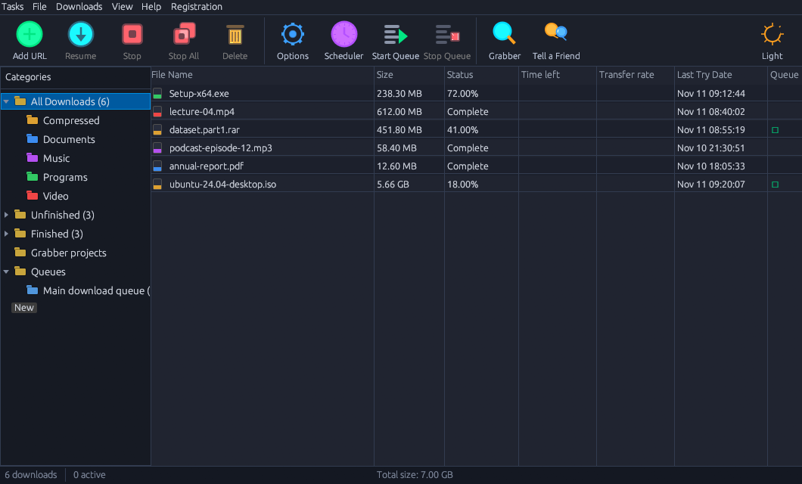

<div align="center">


# Iran Download Manager — مدیر دانلود ایران

**مدیر دانلود رایگان و متن‌باز برای ویندوز، ساخته‌شده با Rust**
<br>
**A free, open-source download manager for Windows — built in Rust**

[](LICENSE)
[](https://github.com/mohammadreza-fallah98/Iran-Download-Manager/releases)
[](https://www.rust-lang.org/)
[](https://github.com/emilk/egui)

[**⬇ دانلود / Download**](https://github.com/mohammadreza-fallah98/Iran-Download-Manager/releases/latest) &nbsp;|&nbsp; [**idm.asratech.ir**](https://idm.asratech.ir/)

</div>

---

## ✨ امکانات / Features

<div dir="rtl" align="right">

| امکان | توضیح |
|---|---|
| ⚡ **دانلود چندتکه‌ای** | تا ۳۲ اتصال هم‌زمان برای هر فایل |
| ⏸️ **توقف و ادامه** | ادامه‌ی دانلودهای نیمه‌کاره با دقت بایت |
| 🗂️ **صف‌های چندگانه** | چند صف نام‌دار، انتقال بین صف‌ها، شروع و توقف هر صف جدا |
| ⏰ **زمان‌بندی** | شروع و توقف خودکار در ساعت دلخواه |
| 🎬 **دانلود ویدیو** | دکمه‌ی دانلود روی ویدیوی مرورگر؛ فایل مستقیم، HLS (حتی AES-128) و DASH بدون ffmpeg |
| 🌐 **افزونه‌ی مرورگر** | Chrome/Edge (MV3) و Firefox (MV2)؛ نشان دانلود کنار لینک‌ها |
| 🔌 **شبکه** | پروکسی HTTP، SOCKS5 و PAC؛ دانلود FTP؛ ورود به سایت‌های رمزدار (رمزنگاری با حساب ویندوز) |
| 🚦 **محدودیت‌ها** | سقف سرعت هر دانلود و کل برنامه، سهمیه‌ی مگابایت در ساعت، اتصال ویژه‌ی هر سرور |
| 🪟 **پنجره‌های مستقل** | پنجره‌ی اطلاعات فایل و پایان دانلود جدا از پنجره‌ی اصلی؛ برنامه در سینی می‌ماند |
| 🖱️ **انتخاب چندتایی** | کشیدن ماوس، Shift+کلیک، Ctrl+A و حذف گروهی با Delete |
| 📋 **کلیپ‌بورد و Grabber** | شناسایی خودکار لینک‌ها، استخراج لینک از صفحه، افزودن گروهی |
| 🛡️ **آنتی‌ویروس و اقدام پایانی** | اجرای برنامه‌ی امنیتی روی فایل تمام‌شده؛ خاموش‌کردن، Sleep یا قطع اینترنت بعد از اتمام |
| 🌙 **فارسی و انگلیسی** | رابط دوزبانه با تم تیره و روشن |
| 📁 **پوشه‌ی هر دسته** | مرتب‌سازی خودکار در Compressed، Documents، Music، Programs، Video |

</div>

| Feature | Description |
|---|---|
| ⚡ **Multi-connection download** | Up to 32 parallel connections per file |
| ⏸️ **Pause & resume** | Resume interrupted downloads with byte-range precision |
| 🗂️ **Multiple queues** | Named queues, move files between them, start/stop each queue |
| ⏰ **Scheduler** | Start and stop downloads at a chosen time of day |
| 🎬 **Video download** | Button over browser videos; direct files, HLS (even AES-128) and DASH without ffmpeg |
| 🌐 **Browser extensions** | Chrome/Edge (MV3) and Firefox (MV2); a download badge next to links |
| 🔌 **Network** | HTTP, SOCKS5 and PAC proxies; FTP; sites that need a login (encrypted with your Windows account) |
| 🚦 **Limits** | Per-download and global speed limit, MB-per-hours quota, per-server connection limits |
| 🪟 **Separate windows** | File info and download-complete windows are independent; the app stays in the tray |
| 🖱️ **Multi-select** | Mouse drag, Shift+click, Ctrl+A and bulk delete with Delete |
| 📋 **Clipboard & Grabber** | Detects copied links, extracts links from a page, batch add |
| 🛡️ **Antivirus & finish actions** | Run a scanner on finished files; shut down, sleep or disconnect when done |
| 🌙 **Persian & English** | Bilingual interface with dark and light themes |
| 📁 **Category folders** | Auto-sorts into Compressed, Documents, Music, Programs, Video |

---

## 📸 تصویر / Screenshot



---

## 🚀 دانلود / Download

<div dir="rtl" align="right">

از بخش [**Releases**](https://github.com/mohammadreza-fallah98/Iran-Download-Manager/releases/latest) فایل‌ها را بگیرید:

- `IranDownloadManager.zip` — برنامه‌ی ویندوز (نصب لازم نیست؛ zip را باز کنید و `IranDownloadManager.exe` را اجرا کنید)
- `IranDownloadManager-chrome-*.zip` — افزونه‌ی Chrome/Edge
- `IranDownloadManager-firefox-*.xpi` — افزونه‌ی Firefox

نسخه‌ی وب‌سایت: [idm.asratech.ir](https://idm.asratech.ir/)

</div>

Get the files from [**Releases**](https://github.com/mohammadreza-fallah98/Iran-Download-Manager/releases/latest):

- `IranDownloadManager.zip` — the Windows app (no installer: unzip and run `IranDownloadManager.exe`)
- `IranDownloadManager-chrome-*.zip` — Chrome/Edge extension
- `IranDownloadManager-firefox-*.xpi` — Firefox extension

Website: [idm.asratech.ir](https://idm.asratech.ir/)

---

## 🧩 افزونه‌های مرورگر / Browser Extensions

<div dir="rtl" align="right">

| مرورگر | فایل | نصب |
|---|---|---|
| **Chrome / Edge** | `IranDownloadManager-chrome-*.zip` | zip را باز کنید؛ `chrome://extensions` › Developer mode › Load unpacked |
| **Firefox** | `IranDownloadManager-firefox-*.xpi` | از [Firefox Add-ons](https://addons.mozilla.org/) (پس از تأیید)، یا آزمایشی: `about:debugging` › Load Temporary Add-on |

ابتدا برنامه را اجرا کنید؛ افزونه فقط با برنامه‌ی روی همان کامپیوتر (`127.0.0.1:6800`) حرف می‌زند. برای دانلود با خود مرورگر هنگام کلیک `Alt` را نگه دارید.

</div>

| Browser | File | Install |
|---|---|---|
| **Chrome / Edge** | `IranDownloadManager-chrome-*.zip` | Unzip, then `chrome://extensions` › Developer mode › Load unpacked |
| **Firefox** | `IranDownloadManager-firefox-*.xpi` | From [Firefox Add-ons](https://addons.mozilla.org/) (once approved), or temporarily: `about:debugging` › Load Temporary Add-on |

Start the app first; the extension only talks to the app on the same computer (`127.0.0.1:6800`). Hold `Alt` while clicking to let the browser download instead.

---

## 🛠️ ساخت از سورس / Build from Source

<div dir="rtl" align="right">

**پیش‌نیاز:** [Rust](https://rustup.rs/) (stable) و ویندوز

</div>

**Requirements:** [Rust](https://rustup.rs/) (stable) on Windows

```bash
git clone https://github.com/mohammadreza-fallah98/Iran-Download-Manager.git
cd Iran-Download-Manager
run-frontend.bat          # dev run / اجرای توسعه
deploy-windows.bat        # tests + release exe + extension packages → Release/
```

```bash
cd windows-form
cargo run                 # development / توسعه
cargo test --release      # unit tests / تست‌ها
cargo build --release     # target/release/iran-download-manager.exe
```

<div dir="rtl" align="right">

اسکریپت `deploy-windows.bat` تست‌ها را اجرا می‌کند، exe را در `Release\EXE` می‌سازد و بسته‌های افزونه را در `Release\Extensions` (به‌صورت پوشه، zip و xpi) قرار می‌دهد. نسخه‌ها از `Cargo.toml` و `manifest.json` خوانده می‌شوند.

</div>

`deploy-windows.bat` runs the tests, builds the exe into `Release\EXE` and puts the extension packages (folders, zip and xpi) in `Release\Extensions`. Versions come from `Cargo.toml` and the `manifest.json` files.

---

## 🏗️ معماری / Architecture

```
Iran-Download-Manager/
├── windows-form/            Rust + egui desktop app / برنامه‌ی دسکتاپ
│   ├── src/
│   │   ├── main.rs          Entry point / نقطه‌ی ورود
│   │   ├── app.rs           UI, dialogs, options, queues / رابط کاربری
│   │   ├── engine.rs        Multi-part HTTP downloader / دانلود چندتکه‌ای
│   │   ├── hls.rs           HLS (m3u8) + AES-128
│   │   ├── dash.rs          DASH (mpd) + built-in MP4 merger
│   │   ├── ftp.rs           FTP with resume
│   │   ├── net.rs           HTTP client, proxy/PAC/SOCKS5, probe
│   │   ├── server.rs        Local server (extensions) :6800
│   │   ├── tray.rs          Tray icon, single instance, window control
│   │   ├── i18n.rs          Persian/English + letter shaping
│   │   ├── secret.rs        Password protection (DPAPI)
│   │   ├── sound.rs         Notification sounds
│   │   ├── model.rs         Data models and settings
│   │   └── widgets.rs       Theme, icons, custom widgets
│   ├── assets/              Icon, font, screenshot
│   └── extensions/          chrome/ and firefox/
├── Website/                 idm.asratech.ir landing page + nginx config
├── Release/                 Built exe and extension packages
├── run-frontend.bat         Dev run
├── deploy-windows.bat       Release build
└── deploy-linux-website.bat Publish the website
```

<div dir="rtl" align="right">

**نکته‌های طراحی:**
- هر دانلود thread خودش را دارد؛ `Arc<Shared>` (Mutex + AtomicBool) رابط و موتور را هماهنگ می‌کند.
- وضعیت هر ۳ ثانیه با نوشتن اتمی (`tmp → rename`) در `%APPDATA%\IranDownloadManager\downloads.json` ذخیره می‌شود.
- افزونه‌ها با `POST /add` و `GET /config` به `http://127.0.0.1:6800` وصل می‌شوند.
- رمزها فقط به‌صورت رمزنگاری‌شده با DPAPI ذخیره می‌شوند؛ کوکی مرورگر فقط در حافظه می‌ماند.
- جزئیات کامل: [`windows-form/ARCHITECTURE.md`](windows-form/ARCHITECTURE.md) و [`BUSINESS.md`](BUSINESS.md).

</div>

**Key design decisions:**
- Each download runs in its own threads; a shared `Arc<Shared>` (Mutex + AtomicBool) coordinates UI ↔ engine.
- State is persisted every 3 seconds with an atomic `tmp → rename` write to `%APPDATA%\IranDownloadManager\downloads.json`.
- Extensions talk to `http://127.0.0.1:6800` with `POST /add` and `GET /config`.
- Passwords are stored only encrypted with DPAPI; browser cookies stay in memory.
- Full details: [`windows-form/ARCHITECTURE.md`](windows-form/ARCHITECTURE.md) and [`BUSINESS.md`](BUSINESS.md).

---

## 📦 فناوری‌ها / Tech Stack

| Library | Version | Purpose / کاربرد |
|---|---|---|
| [eframe](https://github.com/emilk/egui) | 0.31 | Window & event loop / پنجره |
| [egui](https://github.com/emilk/egui) | 0.31 | Immediate-mode GUI / رابط کاربری |
| [ureq](https://github.com/algesten/ureq) | 2 | HTTP client (+SOCKS5) / کلاینت HTTP |
| [tiny_http](https://github.com/tiny-http/tiny-http) | 0.12 | Local HTTP server / سرور محلی |
| [serde_json](https://github.com/serde-rs/json) | 1 | State persistence / ذخیره‌ی وضعیت |
| [chrono](https://github.com/chronotope/chrono) | 0.4 | Scheduler / زمان‌بندی |
| [image](https://github.com/image-rs/image) | 0.25 | Icon loading / آیکون |

---

## 📄 مجوز / License

<div dir="rtl" align="right">

این پروژه با مجوز **MIT** منتشر شده است؛ استفاده‌ی شخصی و تجاری آزاد است.

</div>

This project is licensed under the **MIT License** — free for personal and commercial use.

---

<div align="center">
ساخته‌شده با ❤️ در Rust &nbsp;|&nbsp; Made with ❤️ in Rust &nbsp;|&nbsp; الهام‌گرفته از IDM / Inspired by IDM
</div>
